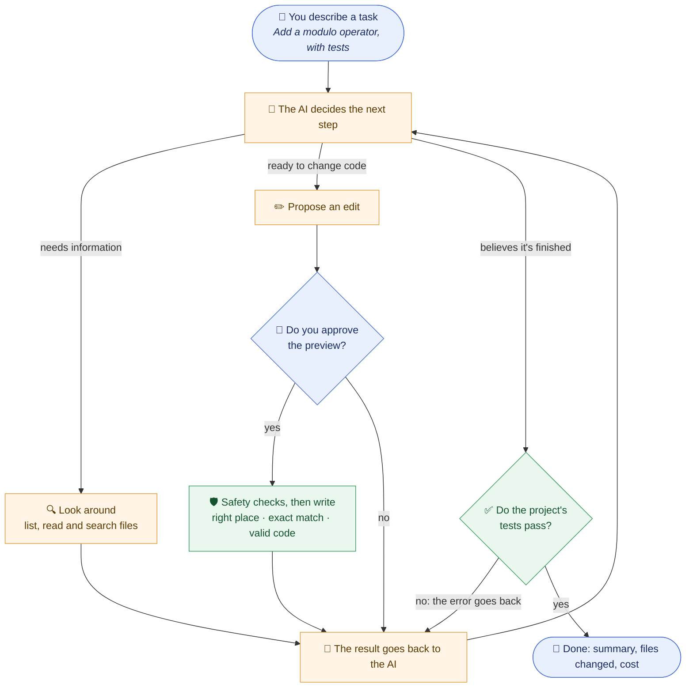
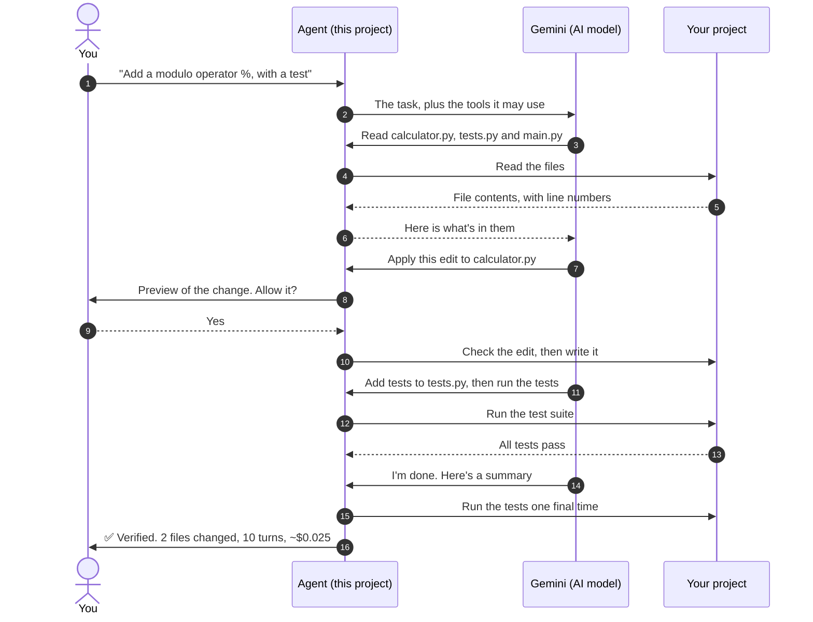
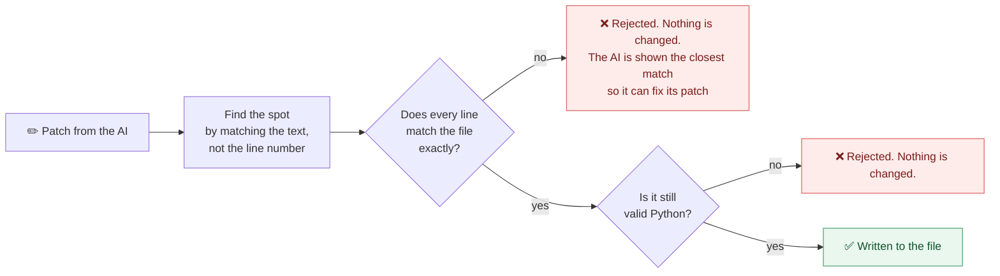
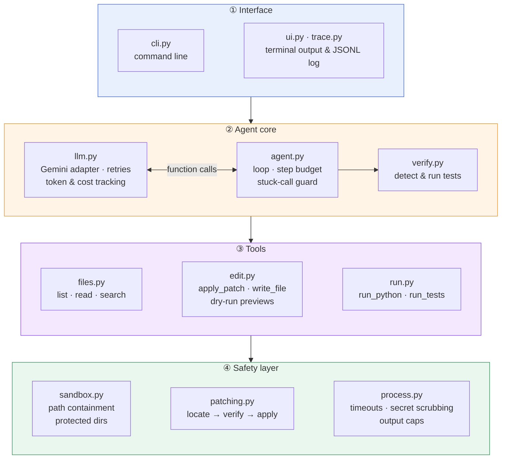

# Autonomous Coding Agent

[](https://github.com/asequas/autonomous-coding-agent/actions/workflows/ci.yml)


**Describe a change in plain English. The agent reads your project, makes the change,
runs your tests, and only reports "done" once they pass.**

It is built from scratch on Google's Gemini models, without an agent framework, so
every step it takes is visible, tested and explained below.

<p align="center">
  
</p>

<p align="center"><sub>A real, unedited run on <code>examples/calculator</code>:
10 model turns, 34k input tokens, about $0.025 with <code>gemini-3.8-flash</code>.</sub></p>

## What it does, in plain English

Think of a capable junior developer working under three rules:

1. **Stay in the project folder.** It can read and edit files only inside the folder
   you point it at, and never your settings, your other projects or your passwords.
2. **Show every change before making it.** Each edit appears as a before-and-after
   preview, and nothing happens until you say yes (unless you choose auto-approve).
3. **Prove the work.** It isn't finished when it *thinks* it is. It's finished when the
   project's own automated tests pass. If they fail, it reads the error and keeps going.

### Results at a glance

| | |
| --- | --- |
| **Tasks solved** | **8 of 8** realistic coding tasks, checked by tests the agent never saw |
| **Total cost** | **$0.41** for all eight, about 5 cents per task |
| **Time** | About **1 minute** per task on average, at most 2.5 minutes |
| **Reliability** | **99 automated checks** run on every change, on Python 3.11–3.14 |

## How it works

### The big picture



The agent works in a loop. Each round, the AI model either asks to use a **tool**
(read a file, search, edit, run tests) or says it is finished. The agent carries out
the request, reports back what happened, and the AI decides the next step. A typical
task takes 7 to 15 rounds.

### One task, step by step

This is the demo run above, as a conversation between the parts. The demo used
auto-approve; this shows the default mode, where you approve each change:



## What makes it trustworthy

### 1. Edits are surgical, and checked before they touch a file

Many AI tools rewrite a whole file to change one line, which wastes money and
sometimes deletes code by accident. This agent sends **patches**: small "replace these
lines with those lines" instructions, like suggested edits in a shared document.



AI models often get line numbers slightly wrong, so the agent locates each change by its
content, the same way GNU `patch` does. If the surrounding text doesn't match exactly,
the AI's picture of the file is out of date, so the edit is refused. **A patch is applied
completely or not at all.** The project's first version had a bug here that silently
corrupted files; that bug is what this design prevents.

### 2. Tests decide when it's done

The AI's own opinion isn't trusted. When it says it's finished, the agent runs the
project's test suite. If anything fails, the error goes straight back to the AI as its
next instruction, up to three times. With no tests in the project, the result is
clearly marked **unverified** rather than reported as success.

### 3. It can't wander off or leak secrets

The AI's instructions are treated as untrusted, because text inside the project it is
reading could try to trick it.

| Risk | What the agent does |
| --- | --- |
| Reaching files outside the project (`../`, absolute paths, shortcuts/symlinks) | Every path is resolved, shortcuts included, and must stay inside the project folder |
| Planting hidden code (git hooks, virtualenv files) | Writes into `.git/`, `.venv/`, `venv/` and `node_modules/` are refused, whatever the capitalisation |
| Approving something other than what runs | Edits are previewed as before-and-after diffs, and prompts show the exact arguments, never shortened |
| The final test run executing project code | It needs your approval, like any other command |
| Leaking your API key | Programs the agent runs get an environment with keys, tokens and secrets removed. Only the key itself is read from `.env`, so a project's `.env` can't redirect traffic |

With `--yes` (auto-approve) the agent runs AI-chosen code on your machine without asking.
Use it inside a container, or on code you trust.

### 4. It watches its own cost

Every run reports how much text was sent to and from the AI, measured in **tokens**
(roughly ¾ of a word each), and what that cost. Because the whole conversation is resent
every round, keeping rounds few and replies short matters.

## Benchmark

**8/8 tasks solved with `gemini-3.8-flash`, for $0.41 in total** (one trial per task,
2026-11-07, estimated at list prices).

Each task is a small project with a request, such as fixing a bug, adding a feature or
renaming something everywhere. It also has **hidden tests** that are copied in only after
the agent finishes, so the agent can't tailor its work to the grading. Every task also
ships a reference solution. An automatic check confirms that each task really is solvable
and that the hidden tests really do catch an unsolved one.

| Task | Kind | Passed | Agent finished | Avg steps | Avg tokens (in / out) | Avg cost | Avg time |
| --- | --- | --- | --- | --- | --- | --- | --- |
| `add-cli-flag` | feature | 1/1 | completed | 12.0 | 56,641 / 5,854 | $0.044 | 69s |
| `calculator-operators` | feature | 1/1 | completed | 14.0 | 101,983 / 6,570 | $0.062 | 75s |
| `divide-by-zero` | bug fix | 1/1 | completed | 14.0 | 71,951 / 3,905 | $0.045 | 63s |
| `extract-helper` | refactor | 1/1 | completed | 7.0 | 16,901 / 1,223 | $0.017 | 24s |
| `fix-pagination` | bug fix | 1/1 | completed | 15.0 | 82,108 / 6,314 | $0.053 | 86s |
| `implement-slugify` | implement | 1/1 | step_limit | 30.0 | 265,867 / 12,241 | $0.113 | 152s |
| `parse-duration` | bug fix | 1/1 | completed | 13.0 | 72,737 / 6,550 | $0.051 | 70s |
| `rename-function` | refactor | 1/1 | completed | 11.0 | 28,446 / 1,355 | $0.026 | 36s |

<sub>**Steps** are rounds of the loop. **Tokens** measure text sent to (in) and from (out)
the AI. **Agent finished** shows whether the agent declared itself done
(`completed`) or was stopped by the 30-step safety limit (`step_limit`).</sub>

**What the numbers say**

- **The miss worth learning from.** On `implement-slugify` the model solved the task and
  its own tests passed, but it spent about 16 steps writing and re-running scratch
  scripts to explore how accented letters behave. It then re-read files instead of
  finishing, and hit the 30-step limit. The hidden tests pass, so the task counts as
  solved, and the run shows exactly where the agent wastes effort. A tool for running
  quick experiments is on the roadmap.
- **Cutting cost by measuring it.** The first benchmark run used 165 rounds and 1.26M
  input tokens. Three changes cut that to 116 rounds and 697k input tokens, with 59%
  served from Gemini's prompt cache. That is 45% fewer input tokens:
  - asking the AI to batch independent requests into one round
  - having edits reply with a one-line summary instead of repeating the change back
  - shortening test-failure output

Run it yourself with `python evals/run_evals.py`. Per-run data is in [`evals/results/`](evals/results).

## Try it

You need Python 3.11+ and a [Gemini API key](https://aistudio.google.com/apikey).

```bash
git clone https://github.com/asequas/autonomous-coding-agent && cd autonomous-coding-agent
uv sync                                  # or: pip install -e .
echo "GEMINI_API_KEY=your-key" > .env

uv run aiagent run "Make division by zero print a friendly error" -C examples/calculator
```

| Option | Meaning |
| --- | --- |
| `-C, --workdir DIR` | Project to work on; the agent can't touch anything outside it |
| `-m, --model NAME` | Gemini model (defaults to `$AIAGENT_MODEL`, then `gemini-3.8-flash`) |
| `-y, --yes` | Don't ask before edits and commands (by default each one needs approval) |
| `--test-command CMD` | How to verify the work; auto-detects pytest or unittest if unset |
| `--trace FILE` | Write a JSONL log of every AI turn, tool call and result |
| `--record FILE.svg` | Save the terminal session as an image, like the demo above |

## Under the hood

For engineers: how the pieces fit together.



1. **Agent loop** ([`agent.py`](src/aiagent/agent.py)). Each model turn either calls
   tools or gives a final answer, and tool results go back as function responses. The
   loop has a step budget and a guard that blocks a repeated identical call when no
   file has changed since, which is a common way LLM agents get stuck.
2. **Tools** ([`tools/`](src/aiagent/tools)). Each tool is declared once as a JSON schema
   plus a handler, and the Gemini function declarations are generated from that list.
   Results carry structured details (the edit, the command result) for the UI and
   traces, while the model gets concise text. A bad call never crashes the run; it
   comes back as an error message the model can act on.
3. **Patch engine** ([`patching.py`](src/aiagent/patching.py)). It accepts unified and
   header-less diffs and finds hunks by content, preferring the match nearest the
   stated line. It tolerates trailing whitespace and always keeps the file's own
   version of context lines. Edits to `.py` files must parse with `ast`.
4. **Verification** ([`verify.py`](src/aiagent/verify.py)). The test command is
   pytest or unittest, detected from the project layout, or `--test-command`. A
   passing test run from the model itself is reused if nothing has changed since.
5. **Gemini adapter** ([`llm.py`](src/aiagent/llm.py)). This is the only module that
   imports the SDK. It keeps the model's own content in history so thinking models get
   their thought signatures back. It uses the SDK's retry policy for 429 and 5xx
   responses, and turns every remaining failure into a clean `error` status.

### Design decisions

- **Patch edits instead of whole-file rewrites.** Rewriting a file to change one line
  wastes tokens and lets the model accidentally drop code it never meant to touch. A
  verified hunk can only change what it says it changes.
- **Strict about context, lenient about line numbers.** Wrong line numbers are harmless
  when the content is unambiguous. Wrong context means the model's view of the file is
  stale, so the patch is rejected with an error showing the actual region.
- **Tests decide when the agent is done.** "The program ran without crashing" is a weak
  signal, and the original version of this project only searched the output for the
  word `Error`. The test suite is the closest thing to the user's definition of done.
- **No agent framework.** The loop is about 120 lines. Owning it makes behaviour like
  stuck-call detection and verification feedback easy to add and test.

### Project layout

```
src/aiagent/
  agent.py      agent loop, RunResult, observer hooks
  llm.py        Gemini adapter + scripted client for tests
  patching.py   diff parser and applier
  sandbox.py    workspace path containment
  verify.py     test-command detection and verification
  process.py    subprocess runner (timeouts, env scrubbing, output caps)
  tools/        files.py · edit.py · run.py, plus the registry
  text.py       line-numbering and truncation shared with the model-facing output
  cli.py ui.py trace.py
evals/          benchmark tasks and runner
examples/       demo project (calculator)
tests/          offline test suite
```

### Development

```bash
uv sync
uv run pytest                               # 99 tests, no API key needed
uv run ruff check . && uv run mypy          # lint + strict type check
uv run python evals/run_evals.py --validate # check benchmark tasks against reference solutions
uv run python evals/run_evals.py            # live benchmark (needs GEMINI_API_KEY; costs money)
```

A scripted stand-in for the AI replays prepared responses, so the whole loop is tested
offline in CI with no API key.

## Glossary

| Term | Meaning |
| --- | --- |
| **Agent** | A program that lets an AI model take actions (read, edit, run) in a loop until a goal is met |
| **LLM / model** | The AI that decides what to do, here Google's Gemini |
| **Tool call** | The AI asking the agent to do one concrete thing, such as "read this file" |
| **Patch / diff** | A precise description of which lines to change, rather than a whole new file |
| **Test suite** | Small programs that check the code behaves correctly; passing tests are the agent's proof of work |
| **Hidden tests** | Extra tests used only for grading the benchmark, never shown to the agent |
| **Token** | The unit AI usage is billed in, roughly ¾ of a word |

## Limitations

- Commands run on your machine with your user's permissions. The sandbox confines file
  tools and removes secrets, but it isn't a container. Keep approval mode (the default)
  on code you care about.
- Verification is only as good as the project's tests. With no tests, a change is
  reported as unverified.
- The benchmark is small and Python-only. It is meant to catch regressions in the
  agent, not to compete with SWE-bench.

## Roadmap

- Container execution backend (Docker) for untrusted repositories
- Context management for long sessions (summarising old tool output)
- A sandboxed `run_snippet` tool, so exploring doesn't need scratch files
- Running the benchmark against more models, with several trials per task

## License

[MIT](LICENSE)
