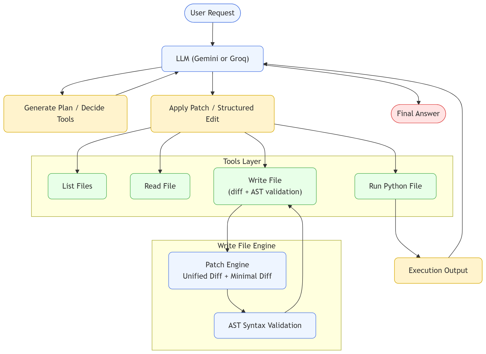

# 🚀 AI Coding Agent — Autonomous Code‑Editing Agent with Patch Engine

This project is a **fully autonomous AI coding agent** capable of:

*   Reading files
*   Editing code using structured operations
*   Applying **unified diff patches**
*   Validating Python syntax with **AST parsing**
*   Running code for **auto‑debugging**
*   Performing self‑healing patch cycles
*   Looping until a stable, correct solution is reached

It behaves similarly to the file‑editing systems in **Cursor**, **Claude Code**, **Copilot Workspace**, and early forms of **Devin**.

***

# ⭐ Features

### 🔧 **1. Intelligent Tool‑Calling Agent**

The agent uses Gemini’s function‑calling API to decide when to:

*   Read files
*   Modify files
*   Apply patches
*   Execute Python
*   List project structure

### 🧠 **2. Patch‑First Code Modification (WriteFile v4)**

The `write_file` tool supports:

*   `mode="write"` — overwrite file
*   `mode="append"` — append text
*   `mode="insert"` — insert at line
*   `mode="replace"` — replace line range
*   `mode="patch"` — apply a real unified diff

Patch mode accepts:

*   **Unified diff**:
        @@ -5,2 +5,3 @@
        - old line
        + new line
*   **Minimal diff**:
         unchanged
        -removed
        +added

This enables **surgical edits** instead of full rewrites.

***

# 🔒 **3. AST‑Based Syntax Validation**

Before *any* Python file is written, the agent:

1.  Reconstructs the full file
2.  Runs `ast.parse()` on the new content
3.  Rejects invalid code safely

This prevents the agent from corrupting files.

***

# 🔁 **4. Autonomous Debug Loop**

After edits:

1.  The agent runs the target Python file
2.  Captures exceptions or runtime errors
3.  Automatically generates a patch to fix them
4.  Repeats until program runs successfully

This is the same mechanism used in IDE‑based AI assistants.

***

# 📂 **5. Sandbox‑Safe File Access**

All operations are limited to a safe working directory:

*   Prevents directory escapes
*   Ensures secure file editing
*   Validates all paths

***

# 🧪 **6. Full Test Suite**

Includes tests for:

*   write
*   append
*   insert
*   replace
*   minimal patch
*   unified diff patch
*   sandbox escape
*   AST validation

***

# 🏗 Architecture Overview

    User Prompt
         ↓
    LLM (Gemini / Groq) 
         ↓
    Produces Tool Call Plan
         ↓
    call_function() 
         ↓
    write_file / get_files / run_python
         ↓
    Tool Output
         ↓
    Back to LLM for evaluation
         ↓
    Patch Corrections / Debugging Loop
         ↓
    Final Answer

***

# 📡 Technologies Used

*   **Python 3**
*   **Google Gemini API (function calling)**
*   **Unified Diff Engine** (custom implementation)
*   **AST Syntax Validation**
*   **Autonomous Execution Loop**
*   **Context‑aware File Editing**
*   **Sandboxing**

***

# 🎮 Example Prompt

    Add support for the modulo operator in calculator.py using minimal patch mode.

Or:

    Insert a comment above the '+' operator inside the operators dictionary using patch mode only.

***

# 🚀 Getting Started

### 1. Install dependencies:

    pip install -r requirements.txt

### 2. Set your Google Gemini API key:

    export GEMINI_API_KEY=your_key_here

### 3. Run the agent:

    python main.py "Add a logging statement to calculator.py using patch mode" --verbose

***

# 💬 Credits

Developed with ❤️ as a demonstration of building **autonomous diff‑aware AI coding tools** from scratch.

***
