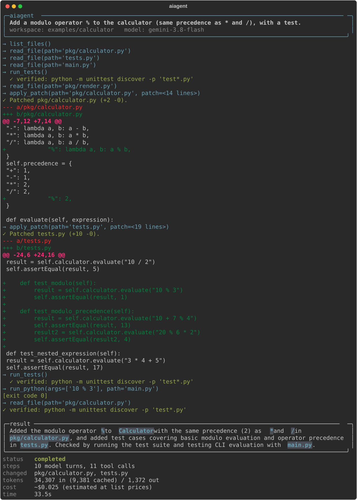
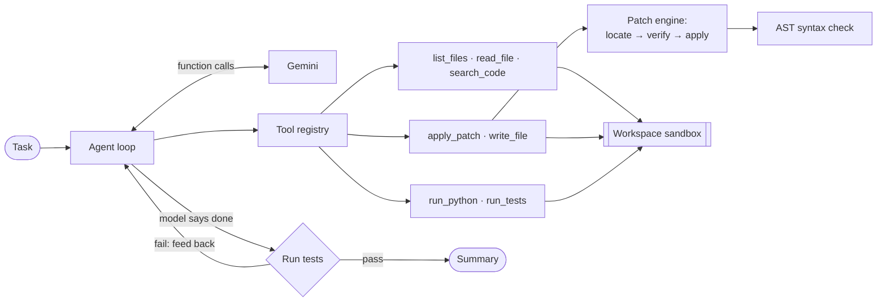

# aiagent: an autonomous coding agent with verified edits

[](https://github.com/asequas/autonomous-coding-agent/actions/workflows/ci.yml)


`aiagent` takes a task in plain English, explores a Python project, edits it with
diff patches, and keeps working until the project's tests pass. It is built from
scratch on Gemini function calling, with no agent framework, so every part of the
loop is visible and tested.

<p align="center">
  
</p>

<p align="center"><sub>A real, unedited run on <code>examples/calculator</code>:
10 model turns, 34k input tokens, about $0.025 with <code>gemini-3.8-flash</code>.</sub></p>

## Highlights

- **Patch engine that fails loudly, not silently.** Hunks are located by content
  (header line numbers are only a hint), every context line is verified, and a
  patch applies all-or-nothing. When a hunk doesn't match, the error shows the
  closest region of the file so the model can repair its patch on the next turn.
- **Test-driven verification.** When the model says it's done, the agent runs the
  project's test suite. Failures go back to the model as a new turn instead of
  ending the run.
- **Approval with previews.** By default every edit and command needs your approval,
  and each edit is shown as a dry-run diff first. Writes into `.git/` or a virtualenv
  are refused outright. See [Safety model](#safety-model).
- **Cost-aware.** The agent tracks input, cached and output tokens and estimates
  the cost of each run. The prompt and tool outputs are designed to keep the resent
  history small.
- **Benchmark with hidden tests.** Eight realistic tasks graded by tests the agent
  never sees. Each task has a reference solution, and a validation step checks
  that every task is both solvable and actually graded.
- **Tested offline.** A scripted LLM client replays model turns, so the whole agent
  loop runs in CI with no API key: 99 tests, mypy `--strict`, ruff, Python 3.11–3.14.

## Benchmark

**8/8 tasks solved with `gemini-3.8-flash`, for $0.41 in total** (one trial per task,
2026-11-07, estimated at list prices). A task counts as solved only when hidden tests,
which the agent never sees, pass afterwards.

| Task | Kind | Passed | Agent finished | Avg steps | Avg tokens (in / out) | Avg cost | Avg time |
| --- | --- | --- | --- | --- | --- | --- | --- |
| `add-cli-flag` | feature | 1/1 | completed | 12.0 | 56,641 / 5,854 | $0.044 | 69s |
| `calculator-operators` | feature | 1/1 | completed | 14.0 | 101,983 / 6,570 | $0.062 | 75s |
| `divide-by-zero` | bug fix | 1/1 | completed | 14.0 | 71,951 / 3,905 | $0.045 | 63s |
| `extract-helper` | refactor | 1/1 | completed | 7.0 | 16,901 / 1,223 | $0.017 | 24s |
| `fix-pagination` | bug fix | 1/1 | completed | 15.0 | 82,108 / 6,314 | $0.053 | 86s |
| `implement-slugify` | implement | 1/1 | step_limit | 30.0 | 265,867 / 12,241 | $0.113 | 152s |
| `parse-duration` | bug fix | 1/1 | completed | 13.0 | 72,737 / 6,550 | $0.051 | 70s |
| `rename-function` | refactor | 1/1 | completed | 11.0 | 28,446 / 1,355 | $0.026 | 36s |

- **Learning from it.** On `implement-slugify` the model solved the task and its own tests
  passed, but it spent about 16 steps writing and re-running scratch scripts to explore
  how Unicode accents behave. It then re-read files instead of finishing, and hit the
  30-step limit. The hidden tests pass, so it counts as solved, and the run shows where
  the agent loses efficiency. A sandboxed "run snippet" tool is on the roadmap so
  exploring doesn't cost two tool calls each time.
- **Measured cost changes.** The first benchmark run used 165 model turns and 1.26M input
  tokens. Three changes cut that to 116 turns and 697k input tokens (59% served from
  Gemini's prompt cache), which is 45% fewer input tokens:
  - a prompt that asks for independent tool calls in one turn
  - edits that reply with a one-line summary instead of echoing the diff
  - shorter test tracebacks

Run it yourself with `python evals/run_evals.py`. Per-run data is in [`evals/results/`](evals/results).

## Quickstart

```bash
git clone https://github.com/asequas/autonomous-coding-agent && cd autonomous-coding-agent
uv sync                                  # or: pip install -e .
echo "GEMINI_API_KEY=your-key" > .env    # https://aistudio.google.com/apikey

uv run aiagent run "Make division by zero print a friendly error" -C examples/calculator
```

| Option | Meaning |
| --- | --- |
| `-C, --workdir DIR` | Project to work on; the agent can't touch anything outside it |
| `-m, --model NAME` | Gemini model (defaults to `$AIAGENT_MODEL`, then a built-in default) |
| `-y, --yes` | Don't ask before edits and commands (by default each one needs approval) |
| `--test-command CMD` | How to verify the work; auto-detects pytest or unittest if unset |
| `--trace FILE` | Write a JSONL trace of every model turn, tool call and result |
| `--record FILE.svg` | Save the terminal session as an SVG |

## How it works



1. **Agent loop** ([`agent.py`](src/aiagent/agent.py)). Each model turn either calls
   tools or gives a final answer. Tool results go back as function responses. The loop
   has a step budget and a guard that blocks the same call with the same arguments
   when no file has changed since, which is a common way LLM agents get stuck.
2. **Tools** ([`tools/`](src/aiagent/tools)). Each tool is declared once as a JSON
   schema plus a handler, and the Gemini function declarations are generated from that
   list. The registry validates arguments and turns every failure into a message the
   model can read, so a bad call never crashes the run.
3. **Patch engine** ([`patching.py`](src/aiagent/patching.py)). Models often miscount
   line numbers, so a hunk is found by its content and the match nearest the stated
   line wins, as with GNU `patch`. Trailing whitespace is tolerated, and context lines
   always keep the file's version. Edits to `.py` files must parse with `ast`.
4. **Verification** ([`verify.py`](src/aiagent/verify.py)). The agent detects pytest or
   unittest from the project layout, or uses `--test-command`. The model is told up
   front that its final answer triggers the tests, and failing output comes back to
   it, up to three times.
5. **Gemini adapter** ([`llm.py`](src/aiagent/llm.py)). This is the only module that
   imports the SDK. It keeps the model's own content in history so thinking models get
   their thought signatures back. It uses the SDK's retry policy for 429 and 5xx
   responses, and turns every remaining failure into a clean `error` status.

### Safety model

The model's tool calls are treated as untrusted: they can be steered by text in the
very repository the agent is reading.

| Risk | Mitigation |
| --- | --- |
| Paths escaping the project (`../`, absolute paths, symlinks) | Every path is resolved, symlinks included, and checked with `Path.is_relative_to` |
| Edits that plant code outside the agent's view (git hooks, `.pth` files) | Writes into `.git/`, `.venv/`, `venv/` and `node_modules/` are refused, case-insensitively |
| Approving something different from what runs | Edits are previewed as diffs; prompts show arguments verbatim and untruncated |
| The test run executing repo code (`conftest.py`) | The automatic test run needs approval like any command |
| Leaking the API key | Child processes get an environment without `*KEY*`, `*TOKEN*` or `*SECRET*` variables. Only the key is read from `.env`, so a repo's `.env` cannot redirect API traffic |

With `--yes` the agent runs model-chosen code on your machine without asking. Use it
in a container or on code you trust.

### Design decisions

- **Patch edits instead of whole-file rewrites.** Rewriting a file to change one line
  wastes tokens and lets the model accidentally drop code it never meant to touch. A
  verified hunk can only change what it says it changes.
- **Strict about context, lenient about line numbers.** Wrong line numbers are
  harmless when the content is unambiguous. Wrong context means the model's view of
  the file is stale, so the patch is rejected with an error showing the actual region.
- **Tests decide when the agent is done.** "The program ran without crashing" is a
  weak signal. The original version of this project searched the output for the
  word `Error`. The test suite is the closest thing to the user's definition of done.
- **No agent framework.** The loop is about 120 lines. Owning it makes behaviour like
  stuck-call detection and verification feedback easy to add and test.

## Project layout

```
src/aiagent/
  agent.py      agent loop, RunResult, observer hooks
  llm.py        Gemini adapter + scripted client for tests
  patching.py   diff parser and applier
  sandbox.py    workspace path containment
  verify.py     test-command detection and verification
  process.py    subprocess runner (timeouts, env scrubbing, output caps)
  tools/        files.py · edit.py · run.py, plus the registry
  text.py       line-numbering and truncation shared with the model-facing output
  cli.py ui.py trace.py
evals/          benchmark tasks and runner
examples/       demo project (calculator)
tests/          offline test suite
```

## Development

```bash
uv sync
uv run pytest                               # 99 tests, no API key needed
uv run ruff check . && uv run mypy          # lint + strict type check
uv run python evals/run_evals.py --validate # check benchmark tasks against reference solutions
uv run python evals/run_evals.py            # live benchmark (needs GEMINI_API_KEY; costs money)
```

## Limitations

- Commands run on the host with your user's permissions. The sandbox confines file
  tools and scrubs secrets, but it isn't a container. Use approval mode (the default)
  on code you care about.
- Verification is only as good as the project's tests. With no tests, a change is
  reported as unverified.
- The benchmark is small and Python-only. It is meant to catch regressions in the
  agent, not to compete with SWE-bench.

## Roadmap

- Container execution backend (Docker) for untrusted repositories
- Context management for long sessions (summarising old tool output)
- A sandboxed `run_snippet` tool, so exploring doesn't need scratch files
- Running the benchmark against more models, with several trials per task

## License

[MIT](LICENSE)
